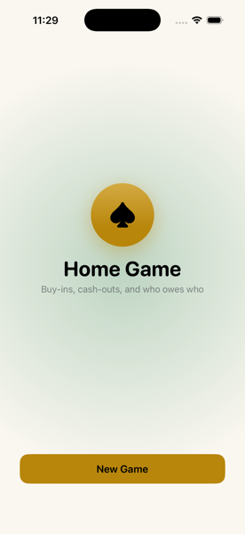
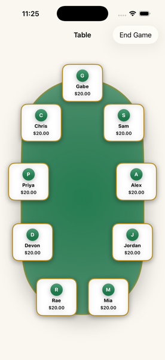

# Home Game

A simple iOS app for running home poker games — track buy-ins, cash-outs, and settle up who owes who at the end of the night.

<p align="center">
  
  &nbsp;&nbsp;
  
</p>

## Features

- **Add players** to a session and set the buy-in amount, small blind, and big blind
- **Oval poker table view** that seats everyone around the felt — scales cleanly up to 9+ players without any overlap
- **Track buy-ins** as players rebuy throughout the game
- **Chip denomination setup** for counting down stacks at the end
- **End-of-game review** and **settle up** screen showing exactly who owes who, minimizing the number of payments needed
- Local persistence via SwiftData — game history stays on-device

## Tech stack

- **SwiftUI** for the UI
- **SwiftData** for local persistence
- Built with Xcode, targeting **iOS 26.5+**

## Getting started

1. Clone the repo
2. Open `Home Game.xcodeproj` in Xcode
3. Build and run on an iOS 26.5+ simulator or device

## Project structure

```
Home Game/
├── Models/        # SwiftData models: Player, Session, SessionPlayer, BuyInEvent, ChipDenomination, CashOutCount
├── Views/          # SwiftUI views: StartView, AddPlayersView, TableView, ReviewView, SettleUpView, EndGameView, ...
└── Home_GameApp.swift
```
